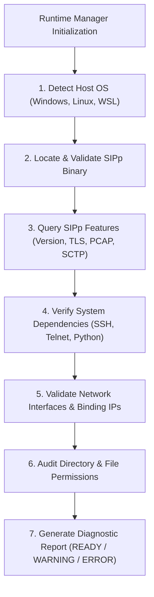

# TARGET APPLICATION ARCHITECTURE: OXE SIP AUTOMATION WEB PLATFORM

**Date**: November 14, 2026  
**Architect**: Senior Software Architect / Python Backend Architect  
**Scope**: End-to-end design for the modern, cross-platform browser-based OXE SIP Automation Toolkit.

---

## 1. Architectural Principles & High-Level Overview

The target application transforms the toolkit from a collection of CLI scripts into a modern, decoupled web application while preserving 100% of the underlying SIP scenarios, OXE routing conventions, and test logic.

### Core Architectural Decisions

1. **Strict Separation of Concerns**: The frontend (React/TypeScript) is purely presentational and never invokes shell commands or touches XML/CSV files directly. The backend (FastAPI/Python 3) owns scenario resolution, environment profiles, process lifecycle, SIPp execution, and results persistence.
2. **Platform Abstraction Layer**: Operating-system-specific tasks (process creation, process termination, path translation, runtime invocation) are encapsulated in dedicated adapters (`WindowsAdapter`, `LinuxAdapter`, `WSLAdapter`) adhering to a unified abstract base class (`PlatformAdapter`).
3. **Engine Preservation**: Existing XML scenario files remain 100% untouched. The backend dynamically generates the exact CSV injection format expected by the scenarios and executes the SIPp binary with identical command-line arguments.
4. **Non-Blocking Real-Time Streaming**: Test execution status, call counters, error rates, and live logs are streamed from the backend to the browser via WebSockets, eliminating heavy polling.

```mermaid
graph TD
    subgraph Frontend ["Frontend (Browser - React + Vite + TypeScript)"]
        UI_Dash["Dashboard & System Health"]
        UI_Env["Environment Manager (Profiles)"]
        UI_Cat["Scenario Catalogue & Configuration"]
        UI_Pre["Preflight Validation Console"]
        UI_Exec["Live Execution & Log Monitor (WebSocket)"]
        UI_Rep["Test History & Diagnostic Reports"]
    end

    subgraph Backend ["Backend API (FastAPI / Python 3)"]
        API_Routes["REST Endpoints & WebSocket Router"]
        
        subgraph CoreServices ["Core Application Services"]
            Svc_Runtime["OXE Runtime Manager"]
            Svc_Env["Environment & Configuration Service"]
            Svc_CSV["CSV Injection Generation Engine"]
            Svc_Scenario["Scenario Discovery & Catalog Service"]
            Svc_Exec["Test Execution & Process Lifecycle Engine"]
            Svc_PBX["OXE PBX Remote Provisioning Service"]
            Svc_Sync["Peer Node Synchronization Service"]
            Svc_History["Results & Metrics Persistence (SQLite)"]
        end

        subgraph AbstractionLayer ["Platform Abstraction Layer"]
            PAL_Base["PlatformAdapter (Abstract Base Class)"]
            PAL_Linux["LinuxNativeAdapter (POSIX signals, /proc)"]
            PAL_Win["WindowsWSLAdapter (wsl.exe bridge)"]
            PAL_WinNat["WindowsNativeAdapter (Win32 process)"]
        end
    end

    subgraph Engine ["SIP Automation Engine (Local or Remote)"]
        SIPp_Bin["SIPp Binary Engine (v3.7.x)"]
        Scenarios_XML["Preserved OXE XML Scenarios (Unchanged)"]
        Dynamic_CSVs["Dynamically Generated CSV Files (chmod 600)"]
    end

    subgraph TargetPBX ["Telecom Infrastructure"]
        OXE_PBX["Alcatel-Lucent OmniPCX Enterprise (172.19.112.51)"]
    end

    Frontend <-->|REST API & WebSockets| Backend
    CoreServices --> PAL_Base
    PAL_Base --> PAL_Linux
    PAL_Base --> PAL_Win
    PAL_Base --> PAL_WinNat
    PAL_Base -->|Spawns & Monitors| SIPp_Bin
    SIPp_Bin -->|Executes| Scenarios_XML
    SIPp_Bin -->|Reads| Dynamic_CSVs
    SIPp_Bin <-->|SIP Signaling (UDP/TCP)| OXE_PBX
    Svc_PBX <-->|SSH / Telnet| OXE_PBX
```

---

## 2. OXE Runtime Manager Design

The **OXE Runtime Manager** is an autonomous Python service running inside the backend that inspects, validates, and reports on the host execution environment.

### Capabilities and Diagnostic Hierarchy



### Structured Diagnostic Output Schema (`GET /api/system/runtime`)

```json
{
  "status": "READY",
  "platform": {
    "os": "Windows",
    "release": "10.0.26100",
    "architecture": "AMD64",
    "python_version": "3.12.4",
    "is_admin": false
  },
  "runtimes": [
    {
      "id": "wsl-ubuntu",
      "name": "WSL2 Ubuntu SIPp Engine (Recommended)",
      "type": "WSL",
      "executable": "wsl -d Ubuntu -- sipp",
      "available": true,
      "version": "3.7.7-TLS-SCTP-PCAP-SHA256",
      "capabilities": {
        "tls": true,
        "pcap": true,
        "sctp": true,
        "ipv6": true
      },
      "active": true
    },
    {
      "id": "win32-native",
      "name": "Windows Native Binary",
      "type": "NATIVE",
      "executable": "C:\\Tools\\sipp\\sipp.exe",
      "available": false,
      "version": null,
      "capabilities": {},
      "active": false
    }
  ],
  "dependencies": {
    "ssh": { "available": true, "path": "C:\\Windows\\System32\\OpenSSH\\ssh.exe" },
    "telnet": { "available": true, "path": "C:\\Windows\\System32\\telnet.exe" },
    "wsl": { "available": true, "path": "C:\\Windows\\System32\\wsl.exe" }
  },
  "diagnostics": {
    "warnings": [],
    "errors": [],
    "recommendations": []
  }
}
```

---

## 3. Platform Abstraction Layer (PAL)

To prevent platform checks (`if os.name == 'nt'`) from proliferating throughout business logic, the application uses an abstract base class pattern:

```python
from abc import ABC, abstractmethod
from typing import List, Dict, Any, Optional
import subprocess

class PlatformAdapter(ABC):
    @abstractmethod
    def build_sipp_command(self, binary: str, args: List[str], cwd: str) -> List[str]:
        """Translate arguments and paths into an OS-executable command list."""
        pass

    @abstractmethod
    def spawn_process(self, cmd: List[str], cwd: str, env: Dict[str, str]) -> subprocess.Popen:
        """Spawn a process in an isolated process group for clean lifecycle management."""
        pass

    @abstractmethod
    def terminate_process_group(self, proc: subprocess.Popen) -> None:
        """Gracefully terminate or kill a running process and all child threads/processes."""
        pass

    @abstractmethod
    def resolve_path(self, path_str: str) -> str:
        """Normalize paths across Windows, POSIX, and WSL boundaries."""
        pass
```

### Concrete Implementations
1. **`LinuxRuntimeAdapter` (`apps/backend/adapters/runtime/linux.py`)**:
   - Native POSIX platform adapter.
   - Inspects `/etc/os-release`, queries local `/usr/bin/sipp`, and verifies POSIX signal capabilities (`SIGINT`, `SIGTERM`).
2. **`WindowsWslRuntimeAdapter` (`apps/backend/adapters/runtime/windows_wsl.py`)**:
   - Detects `wsl.exe`, queries installed Linux distributions, and handles missing distributions gracefully (`status="UNAVAILABLE"`).
   - Translates Windows paths to `/mnt/c/...` via `wslpath` logic and invokes commands inside the selected WSL2 distribution.
3. **`WindowsRuntimeAdapter` (`apps/backend/adapters/runtime/windows.py`)**:
   - Native Win32 platform adapter.
   - Audits Windows OS version, system architecture, and local executables.
4. **`RemoteLinuxRuntimeAdapter` (`apps/backend/adapters/runtime/remote_linux.py`)**:
   - Orchestrates remote Linux execution nodes (CALLER `172.19.112.50`, CALLED `172.19.112.60`) over OpenSSH.
   - Uses parameterized argument arrays, connection timeouts (5s), and strict credential masking.

---

## 4. Runtime & Environment Management Architecture

### 4.1 Runtime Manager (`apps/backend/adapters/runtime/manager.py`)
The `RuntimeManager` acts as the central coordinator for all execution environments:
- Auto-discovers local execution runtimes (Native Windows, WSL2, Native Linux).
- Manages registration and persistence of remote Linux execution nodes (`RemoteLinuxRuntimeAdapter`).
- Validates runtime health and prerequisite binaries on demand.
- Stores runtime definitions in SQLite (`database/sipp_platform.db`) via `RuntimeModel`.

### 4.2 Environment Manager (`apps/backend/services/environment_service.py`)
The `EnvironmentManager` coordinates test target topologies:
- Persists PBX configuration profiles (`PBXConfig`: IP `172.19.112.51`, Port `5060`, Trunk Group `4`, Domain).
- Associates environments with CALLER and CALLED runtime nodes.
- Flags demonstration profiles (`is_demo=True`) for safe UI simulation.
- Executes readiness audits (`validate_environment_readiness`) ensuring PBX parameters are valid and associated runtimes are reachable.

---

## 5. Execution Host Topologies: Local vs. Remote Agent

### Approach A: Local Execution Architecture (Initial MVP)
- The web backend and SIPp execute on the same host machine.
- **Advantages**: Minimal latency, zero deployment overhead, simple process inspection, straightforward debugging.
- **Suitability**: Perfectly suited for single-user labs and development stations.

### Approach B: Distributed Remote Execution Agent (Release 2 Target)
- The web frontend/backend runs on a central server (or engineer laptop).
- A lightweight Python agent (`oxe-sip-agent`) runs on CALLER (`172.19.112.50`) and CALLED (`172.19.112.60`).
- **Communication**: Mutual TLS (mTLS) REST or secure WebSocket between central backend and remote agents.
- **Transition Strategy**: The backend service interfaces (`TestExecutionEngine`) are identical for both models. In Phase 1, `LocalProcessExecutor` implements the interface. In Phase 2, `RemoteAgentExecutor` implements the exact same interface over network RPC.

---

## 5. Security & Safety Architecture

Because telecom test tools interact directly with physical PBX hardware and network sockets, security controls are built into the architecture:

1. **Zero Shell Concatenation**: Commands are passed exclusively as tokenized argument arrays (`List[str]`), completely preventing shell command injection vulnerabilities.
2. **Credential Sanitization**: Passwords (`AUTH_PASSWORD`, `SIPP_PASS`, `SIPP_ROOT_PASS`) are stored encrypted in SQLite using AES-GCM and masked (`********`) in all REST responses, WebSocket broadcasts, and execution logs.
3. **Restricted File Permissions**: All generated CSV files are strictly created with `chmod 600` permissions (or Windows owner-only ACLs).
4. **Local Port & Resource Locking**: An execution lock manager prevents overlapping test executions from attempting to bind to the same SIP UDP ports (`5060`, `5062`, `5080`) or assigning the same extension ranges.
5. **Session Safety**: Local-only API binding (`127.0.0.1:8000`) for development, with bearer token authentication for network deployments.
