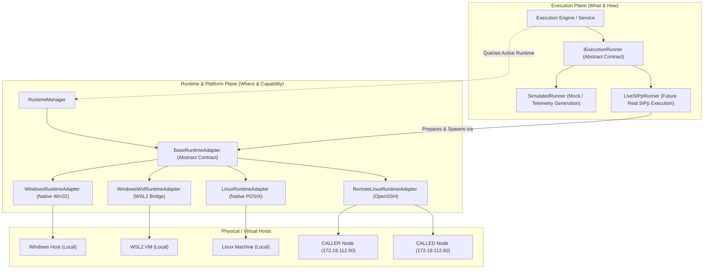
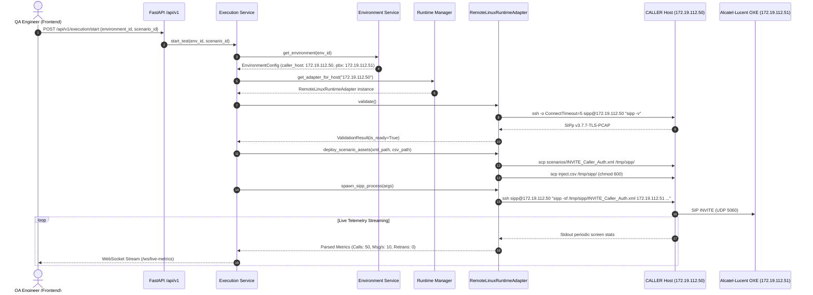

# EXECUTION ARCHITECTURE: RUNNER ABSTRACTION & RUNTIME ADAPTERS

**Date**: November 14, 2026  
**Scope**: Architecture specification defining the separation of concerns between Execution Runners and Platform Runtime Adapters in the OXE SIP Automation Platform.

---

## 1. Architectural Principle: Separation of Concerns

The execution architecture enforces a strict decoupling between **how a SIP test scenario runs** (Execution Runner) and **where it runs** (Platform Runtime Adapter).



---

## 2. Component Responsibilities

### 2.1 Execution Runner (`IExecutionRunner`)
The Execution Runner is responsible for the **test execution lifecycle**:
1. **Scenario Parameterization**: Compiling high-level test configurations (call rate, duration, auth flags, PRACK parameters) into execution arguments.
2. **CSV Injection Generation**: Emitting strictly formatted CSV files adhering to OXE SIP domain standards (`chmod 600`, masked credentials).
3. **Execution Lifecycle**: Initializing, starting, pausing, stepping, and terminating the SIPp execution instances.
4. **Real-time Telemetry Streaming**: Capturing stdout/stderr/screen logs, parsing SIP counter metrics (calls total, calls answered, failed 4xx/5xx/6xx, retransmissions, response times), and publishing metrics via WebSockets.
5. **Result Aggregation**: Producing consolidated test summaries and storing run records in SQLite.

*Invariants*:
- The Runner never assumes it is running on a specific OS.
- The Runner never issues raw system-level socket calls or subprocess calls directly without consulting the Runtime Adapter for path translation and shell wrappers.

### 2.2 Platform Runtime Adapter (`BaseRuntimeAdapter`)
The Platform Runtime Adapter is responsible for **host discovery, capability validation, and process spawning**:
1. **Host Environment Discovery**: Detecting OS kernel, architecture, memory, CPU load, and network interfaces.
2. **Prerequisite & Tool Auditing**: Verifying availability of required binaries (`sipp`, `ssh`, `python3`, `wsl.exe`).
3. **Path Translation**: Converting filesystem paths across operating system boundaries (e.g., Windows `C:\path` to WSL `/mnt/c/path` or remote Linux `/tmp/sipp/...`).
4. **Process Execution & Signal Dispatch**: Spawning processes with safe argument vectors (no raw shell string interpolation) and sending clean POSIX termination signals (`SIGINT`, `SIGTERM`).
5. **Credential & Secret Protection**: Ensuring SSH private keys and passwords are masked in all logs and metadata.

---

## 3. Platform Adapter Hierarchy

All adapters derive from `BaseRuntimeAdapter` (`apps/backend/adapters/runtime/base.py`):

```text
BaseRuntimeAdapter (ABC)
├── WindowsRuntimeAdapter
│   └── Native Windows environment. Reports Windows OS details and verifies local binary paths.
├── WindowsWslRuntimeAdapter
│   └── Detects wsl.exe, queries installed Linux distributions (e.g. Ubuntu), and translates paths via wslpath.
├── LinuxRuntimeAdapter
│   └── Native Linux POSIX execution. Inspects /proc, /etc/os-release, and local sipp binary.
└── RemoteLinuxRuntimeAdapter
    └── Connects over OpenSSH (subprocess ssh/scp) using key or password authentication.
        Enforces strict timeouts, argument arrays, and secret masking.
```

### Key Contract Methods

```python
class BaseRuntimeAdapter(ABC):
    @abstractmethod
    def detect_os(self) -> dict[str, Any]:
        """Query operating system name, release, architecture, and kernel."""
        ...

    @abstractmethod
    def check_sipp_version(self) -> Optional[str]:
        """Detect installed SIPp binary version string."""
        ...

    @abstractmethod
    def check_prerequisites(self) -> dict[str, bool]:
        """Verify presence of all prerequisite tools and libraries."""
        ...

    @abstractmethod
    def validate(self) -> RuntimeValidationResult:
        """Run complete diagnostic check and return ready status with diagnostic logs."""
        ...

    @abstractmethod
    def translate_path(self, local_path: str) -> str:
        """Translate a local workspace path into the runtime's filesystem syntax."""
        ...
```

---

## 4. Execution Sequence Diagram

The following sequence illustrates how the Execution Engine, Runtime Manager, and Target Hosts collaborate to run a test:



---

## 5. Security & Isolation Invariants

1. **No Plaintext Passwords**: `AUTH_PASSWORD` and SSH credentials must never be written to plaintext logs, returned over REST APIs without masking (`********`), or passed via unsecured command line flags.
2. **File Permissions**: All CSV injection files containing credentials or user data must be deployed with POSIX permissions `chmod 600`.
3. **Safe Subprocess Execution**: Subprocesses are spawned using array/vector arguments (`["ssh", "-p", "22", ...]`) rather than shell interpolation (`shell=False`) to prevent command injection vulnerabilities.
4. **Portability**: All file paths are dynamically resolved from the repository root; hardcoded absolute user directory paths are strictly forbidden.
