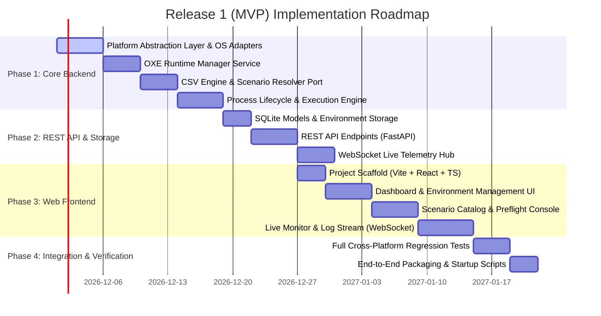

# IMPLEMENTATION ROADMAP: OXE SIP AUTOMATION WEB PLATFORM

**Date**: November 14, 2026  
**Architect**: Senior Software Architect / Project Lead  
**Scope**: Phased transition plan from existing CLI toolkit to the cross-platform web platform.

---

## 1. Phasing Overview & Guiding Rules

The implementation follows a strict **additive, non-destructive migration model**:
- **Preserve Existing Working State**: All existing XML scenarios, baseline scripts, and the CLI `sipp_manager.sh` remain functional throughout development.
- **Zero Green-field Rewrites**: Reusable Python components (`regression_test.py`, provisioning logic from `oxe_remote.py`) are refactored into service classes rather than written from scratch.
- **Strict Evidence Gate**: Moving between phases requires passing all existing 29 regression tests on both Windows (WSL) and Linux.

---

## 2. Release 1: Minimum Viable Product (MVP)

The objective of Release 1 is to deliver a complete, self-contained, browser-based testing system for single-user lab installations on Windows and Linux.

### Detailed Milestone Breakdown

#### Milestone 1.1: Platform Abstraction & Runtime Manager
- **Deliverables**:
  - `backend/app/runtime/base.py`: Abstract `PlatformAdapter`.
  - `backend/app/runtime/linux.py`: Native Linux POSIX adapter.
  - `backend/app/runtime/wsl.py`: Windows WSL2 bridge adapter.
  - `backend/app/runtime/manager.py`: `OXERuntimeManager` service reporting system status, SIPp version, dependencies.
- **Acceptance Criteria**: Unit tests confirm auto-detection of Windows WSL and Linux environments without shell dependencies.

#### Milestone 1.2: Scenario Discovery, CSV Generation & Execution Engine
- **Deliverables**:
  - `backend/app/services/scenario_selector.py`: Port of `select_uac_xml()` and `select_uas_xml()` from `sipp_manager.sh`.
  - `backend/app/services/csv_generator.py`: Port of `generate_csvs()` with strict LF endings, dynamic authentication digest fields, and `chmod 600` permissions.
  - `backend/app/services/execution_engine.py`: Spawns SIPp in an isolated process group, parses live screen statistics via UDP/stdout, and captures output streams.
- **Acceptance Criteria**: 29/29 tests from `regression_test.py` execute successfully through the new Python engine.

#### Milestone 1.3: REST API & WebSocket Telemetry
- **Deliverables**:
  - FastAPI backend serving `/api/system`, `/api/environments`, `/api/scenarios`, `/api/executions`.
  - WebSocket endpoint `/ws/executions/{id}` broadcasting live call rates, SIP response distributions, and log lines.
  - SQLite persistence for environment profiles and test history.
- **Acceptance Criteria**: Complete API contract verified with OpenAPI / Swagger documentation; WebSocket pushes 10Hz updates without dropped frames.

#### Milestone 1.4: React/TypeScript Frontend UI
- **Deliverables**:
  - Modern dashboard showing environment health, runtime readiness, and recent runs.
  - Environment profile editor (PBX IP, node IPs, extension ranges, authentication passwords).
  - Scenario catalogue with category filters (Baseline, Auth, PRACK, Combined).
  - Preflight verification console with PASS/WARN/FAIL indicators.
  - Live execution monitor featuring real-time response code bar charts and auto-scrolling log terminal.
- **Acceptance Criteria**: Fully responsive UI operating seamlessly on Chrome, Edge, and Firefox on Windows and Linux.

---

## 3. Release 2: Advanced Capabilities & Distributed Testing

Release 2 expands the platform from a single-machine workbench to a distributed telecom lab testing suite.

1. **Distributed Remote Execution Agent**:
   - Deploy `oxe-sip-agent` on remote CALLER and CALLED Linux servers.
   - Central web application commands multiple traffic generators simultaneously.
2. **Deep SIP Trace Visualizer**:
   - Interactive ladder / sequence diagram rendering of in-dialog SIP signaling flows extracted from SIPp `-trace_msg` dumps.
3. **Advanced PBX Automation**:
   - Direct integration of subscriber provisioning into the web UI via an OS-independent Paramiko SSH / Telnet service.
4. **Automated Test Comparison & PDF Reporting**:
   - Side-by-side run comparisons highlighting response latency deltas and error rates across software releases.
   - One-click PDF export for test sign-off and compliance documentation.

---

## 4. Technical Risks & Mitigation Matrix

| Technical Risk | Severity | Likelihood | Architectural Mitigation Strategy |
| :--- | :---: | :---: | :--- |
| **Windows Socket Limitations on Native SIPp** | High | High | Make **WSL2 the primary, default Windows runtime**. WSL provides identical Linux kernel socket performance and 100% scenario compatibility. |
| **Process Group Leaks on Forced Termination** | High | Medium | Implement robust OS process group isolation (`os.killpg` on Linux, `taskkill /F /T` on Windows). Never rely solely on PID files. |
| **High Log Volume Overloading Browser WebSocket** | Medium | High | Implement backend log ring-buffering, throttling WebSocket broadcasts to 10 updates per second, and offloading historical logs to disk files. |
| **Password Exposure in REST Logs / Responses** | Critical | Low | Enforce strict Pydantic serializer filters masking passwords (`SecretStr`), and sanitize all log streams before disk or network output. |
| **Port Conflicts on Rapid Consecutive Runs** | Medium | Medium | Implement a backend Port Reservation & Lock Manager that verifies socket release (`SO_REUSEADDR` checks) before launching a new test. |
